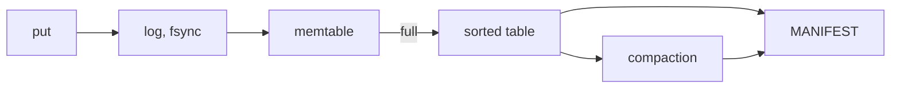

# lsm-lite

[](https://github.com/Urthella/lsm-lite/actions/workflows/ci.yml)

A small LSM-tree key-value store in Rust, about 700 lines, built to show how a storage engine
survives a crash and to test that it does. The tests run it on a simulated filesystem and crash it at
every filesystem operation, losing whatever a real crash could lose, then check that no acknowledged
write is gone.

It's for learning and reading. For real use, look at [fjall](https://github.com/fjall-rs/fjall) or
RocksDB. To build one yourself step by step, [mini-lsm](https://github.com/skyzh/mini-lsm) is a good
course.



## Use it

```rust
use lsm_lite::{Db, Options};

let mut db = Db::open_dir("data", Options::default())?;
db.put(b"apple", b"red")?;
db.delete(b"banana")?;
assert_eq!(db.get(b"apple")?, Some(b"red".to_vec()));
for (key, value) in db.scan(b"a".to_vec()..b"c".to_vec())? {
    println!("{key:?} = {value:?}");
}
```

There's also a small command line:

```bash
cargo run --example kv -- data put apple red
cargo run --example kv -- data get apple
cargo run --example kv -- data scan
```

## How it survives a crash

The rule is that nothing on disk is ever pointed at before it's complete, and nothing is deleted
while something durable still points at it.

- **A write** is appended to the log with a CRC and synced before `put` returns, then goes into the
  memtable.
- **A flush** writes the memtable to a sorted table and syncs it, creates a new log, syncs the
  directory so both names are durable, then replaces the manifest. Only then are old files deleted.
- **The manifest**, which lists the live tables and the current log, is replaced atomically: write
  `MANIFEST.tmp`, sync it, rename it over `MANIFEST`, sync the directory.
- **Compaction** merges every table into one in the same way, dropping deleted keys.
- **Opening** reads the manifest and replays the log, stopping at the first record that's torn or
  fails its CRC. What the log held goes into a table, and writing continues in a new log, so nothing
  is ever appended after a torn end.
- **After a failed write**, the database refuses everything until it's reopened, since what's in
  memory may no longer match the disk.

## How it's tested

`lsm_lite::sim::SimFs` is a filesystem in memory that can crash. When it does:

- data appended since a file's last sync survives up to a random point, and what survives can end in
  zeros, as when a file's new size reached the disk before its data did;
- each create, rename and remove since the last directory sync survives or not, independently;
- a file is lost if its name is.

That's harsher than most real filesystems, which is the point. The tests check that after recovery
the database holds every acknowledged write, and that the write in progress at the crash is either
fully there or not at all:

- **Every crash point:** a 100-write workload that flushes and compacts many times runs 502
  filesystem operations. It's crashed at each one, with 8 different choices of what survives: 4,016
  crashes. Each recovered database also has to keep working.
- **Random crashes:** 300 runs of 300 writes, crashing at random, including during recovery.
- **A real disk:** the `kv` example writing as fast as it can, killed with `kill -9` 30 times in a
  row, during flushes and compactions too. Every write it had reported was there each time. That's
  a process crash only; power loss is what the simulation is for.

To check that the tests can fail, 17 bugs were planted one at a time, and every one was caught.
Among them: not syncing the log, not syncing the directory before the manifest names a new table,
rewriting the manifest in place, deleting the old log before the new manifest is durable, letting
compaction keep older values, and checking CRCs that don't cover the record length, which lets a run
of zeros pass as an empty record.

This way of testing comes from work like
[ALICE](https://www.usenix.org/conference/osdi14/technical-sessions/presentation/pillai) and
[CrashMonkey](https://github.com/utsaslab/crashmonkey), which found bugs like these in real databases
and filesystems.

## Limits

- **One writer.** Writes take `&mut self`; put the database behind a `Mutex` to share it. Flushes
  and compactions run inside `put`, so some writes are slow.
- **Every write waits for its own fsync**, so it does a few hundred writes a second. There are no
  batches or group commit.
- **Compaction rewrites everything.** Fine for small data, not for large.
- **Scans read whole tables**, and keys and values have to fit in memory.
- **A table's CRC is checked once, when it's opened.** Corruption after that isn't caught.
- **The crash model isn't everything a disk can do.** It doesn't reorder writes inside a file or
  damage data that was synced.
- **On Windows the directory can't be synced**, so it relies on NTFS journaling directory changes.

## Tests

```bash
nix develop
cargo test
```

Claude, Anthropic's AI model, wrote this with Halil Utku Demirtaş directing the work.

## License

MIT
